<div align="center">

# 🎮 QuizRoom

### Многопользовательская квиз-игра в реальном времени

**Создай комнату. Пригласи друзей. Отвечай быстрее. Забирай первое место.**

[](https://react.dev/)
[](https://www.typescriptlang.org/)
[](https://vite.dev/)
[](https://tanstack.com/query/latest)
[](https://socket.io/)
[](https://sass-lang.com/)

**Frontend • SPA • Real-time multiplayer • Feature-Sliced Design**

<a href="./assets/readme/game-answer.png">
  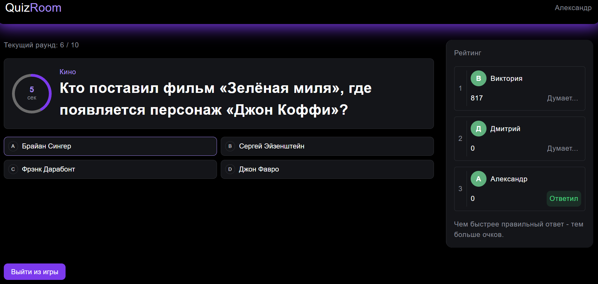
</a>

<sub>Один раунд. Несколько соперников. Секунды решают всё.</sub>

<!-- После публикации проекта можно добавить ссылку на игру:
[🎮 Играть онлайн](ССЫЛКА_НА_ДЕМО)
-->

</div>

---

## ✨ О проекте

**QuizRoom** — веб-приложение для интеллектуальных соревнований с друзьями. Игроки подключаются к общей комнате, выбирают ответы на вопросы с ограничением по времени и следят за рейтингом в реальном времени.

Это не просто интерфейс с набором вопросов: во Frontend реализован **полный многопользовательский сценарий** — от гостевого входа и поиска комнаты до синхронной игры, смены раундов и итоговой таблицы победителей.

Проект разрабатывался с акцентом на **масштабируемую структуру клиентского кода, типобезопасность, синхронизацию серверного состояния и пользовательский опыт**.

### Что умеет QuizRoom

- 👤 **Гостевой вход** — достаточно указать имя, отдельная форма регистрации не требуется.
- 🚪 **Игровые комнаты** — создание, поиск, фильтрация и присоединение.
- 🔒 **Публичные и приватные комнаты** — вход по паролю и приглашение по ссылке.
- ⚙️ **Настройка квиза** — тема, сложность, число раундов, время ответа и лимит игроков.
- 👑 **Роль хоста** — управление настройками и запуск матча.
- ✅ **Система готовности** — хост видит, кто готов к началу игры.
- ⚡ **Многопользовательская игра в реальном времени** — изменения приходят всем участникам без ручного обновления страницы.
- ⏱️ **Таймер на каждый вопрос** — обратный отсчёт по времени завершения раунда, полученному от сервера.
- 🏆 **Рейтинг и результаты** — очки участников, правильные ответы и итоговые места.
- 🔄 **Работа с переподключением** — повторная подписка на события при восстановлении соединения.

---

## 🖼️ Галерея QuizRoom

### 01 — Начни играть за несколько секунд

Без регистрации: придумай имя, найди открытую комнату или создай собственную. Поиск и фильтры помогают быстро выбрать игру.

| Гостевой вход | Список игровых комнат |
|:---:|:---:|
| <a href="./assets/readme/welcome.png">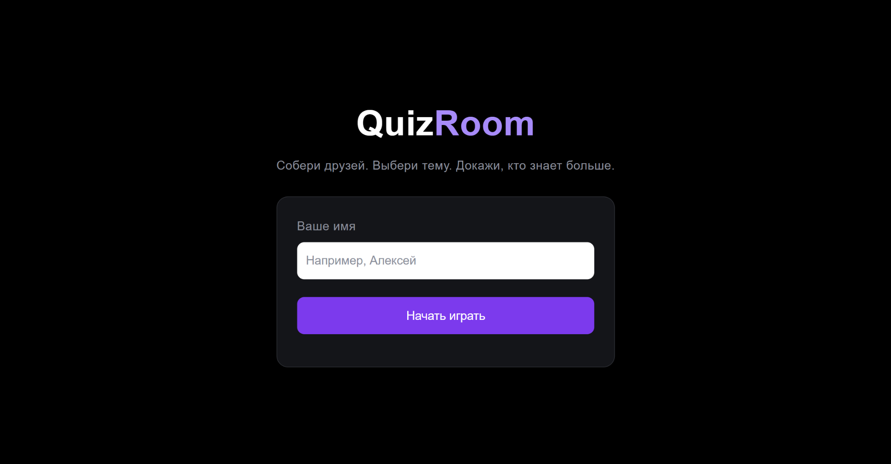</a> | <a href="./assets/readme/rooms.png">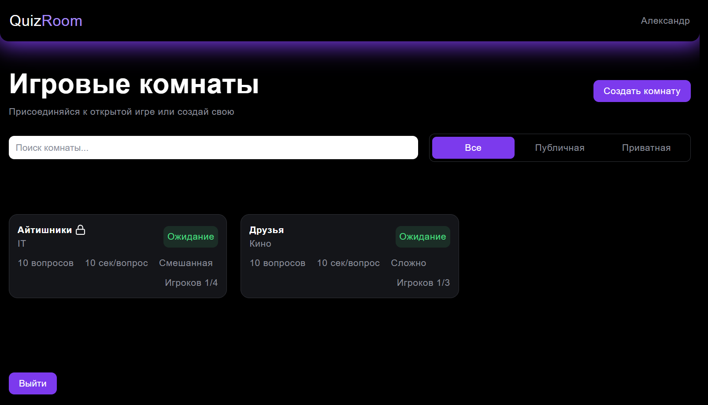</a> |
| **Введи имя и начинай** | **Найди свою игру** |

### 02 — Настрой игру под свою компанию

Тема, сложность, количество вопросов и участников, время на ответ, публичный или приватный доступ — параметры задаются при создании комнаты.

<div align="center">
  <a href="./assets/readme/create-room.png">
    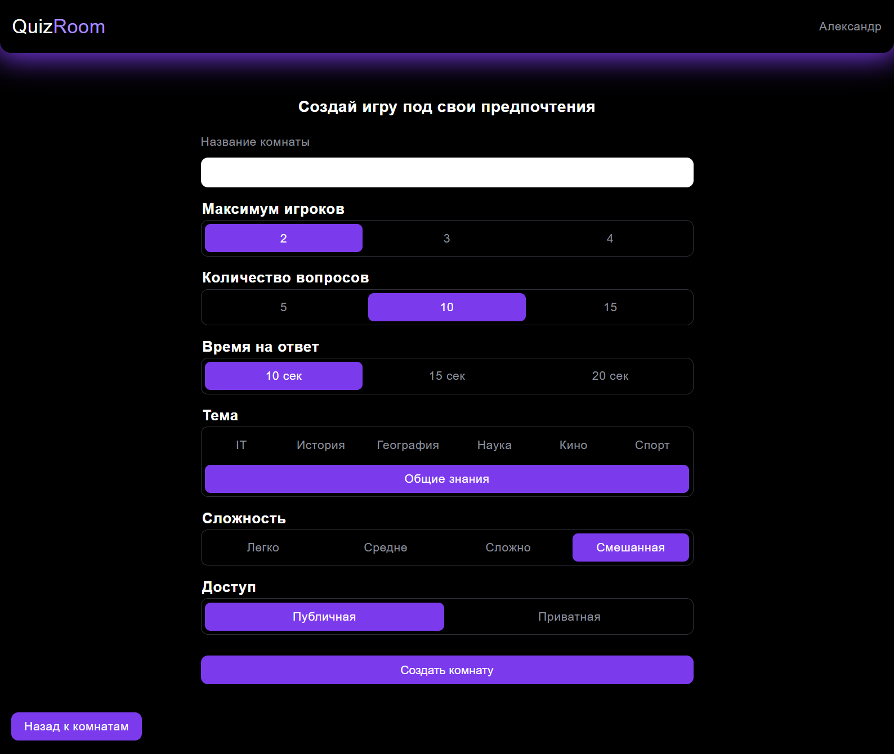
  </a>
  <p><sub>Форма создания комнаты: все настройки квиза в одном месте.</sub></p>
</div>

### 03 — Собери команду в лобби

Игроки отмечают готовность, а хост видит состав комнаты и запускает матч. До старта можно изменять параметры игры; участники получают обновления в реальном времени.

| Лобби глазами игрока | Лобби глазами хоста |
|:---:|:---:|
| <a href="./assets/readme/lobby-player.png">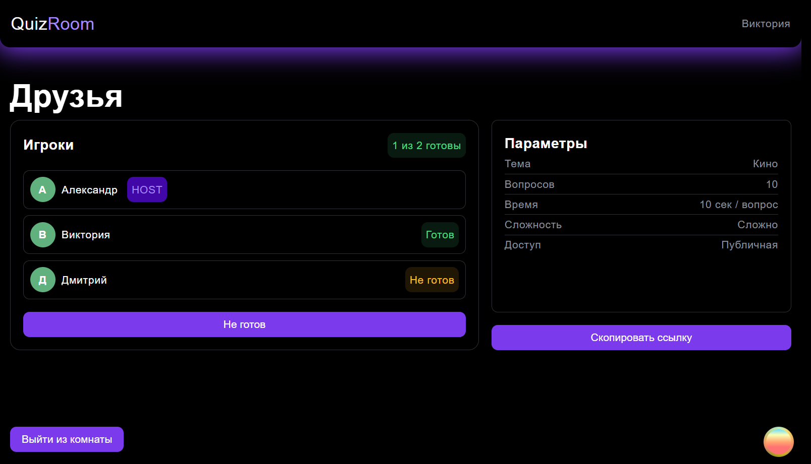</a> | <a href="./assets/readme/lobby-host.png">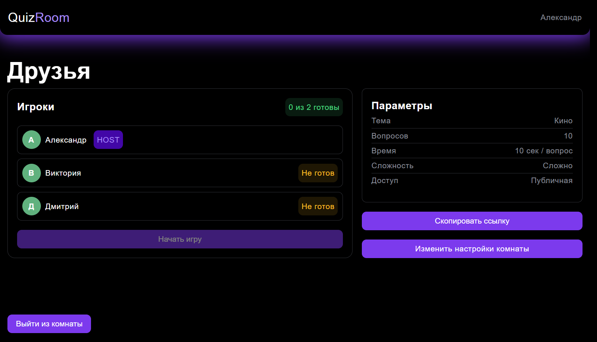</a> |
| **Статус готовности участников** | **Управление комнатой и стартом** |

### 04 — Соревнуйся в реальном времени

Все участники видят один и тот же вопрос и общий рейтинг. Чем быстрее правильный ответ — тем больше очков. После окончания времени интерфейс показывает правильный вариант и выбранный ответ.

<div align="center">
  <a href="./assets/readme/game-answer.png">
    
  </a>
  <p><sub>Фаза ответа · круговой таймер · актуальный рейтинг · статусы игроков</sub></p>
</div>

<div align="center">
  <a href="./assets/readme/game-reveal.png">
    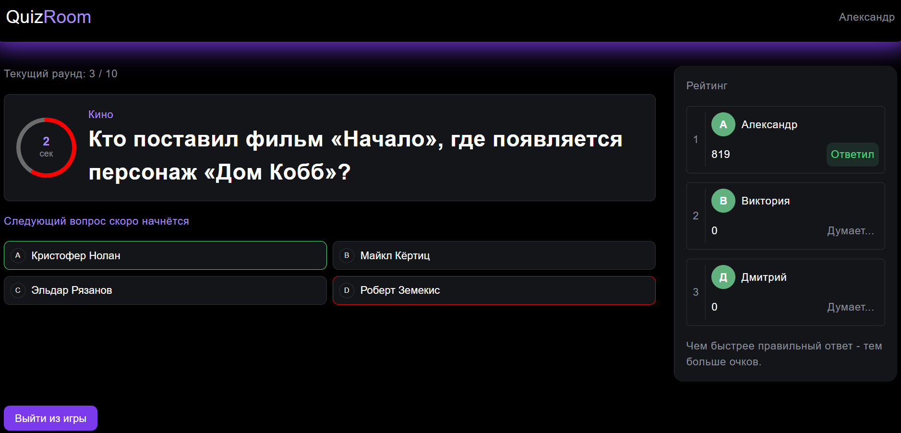
  </a>
  <p><sub>Фаза раскрытия · подсветка правильного и выбранного вариантов · переход к следующему раунду</sub></p>
</div>

### 05 — Узнай, кто победил

После последнего вопроса отображаются победитель, итоговые очки, места участников и количество правильных ответов. Из результатов можно вернуться в лобби.

<div align="center">
  <a href="./assets/readme/results.png">
    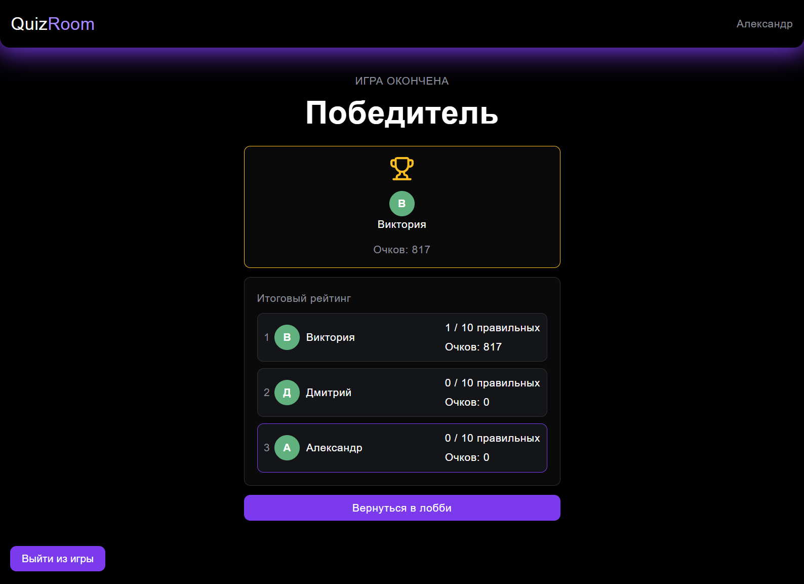
  </a>
  <p><sub>Победитель матча и итоговая таблица результатов</sub></p>
</div>

<details>
<summary><strong>🔐 Дополнительные экраны — приватные комнаты и приглашения</strong></summary>

<br>

Приватную комнату можно защитить паролем, а друзьям отправить приглашение по ссылке. Для приглашённого предусмотрены подтверждение входа и ввод пароля при необходимости.

<div align="center">
  <a href="./assets/readme/password-room.png">
    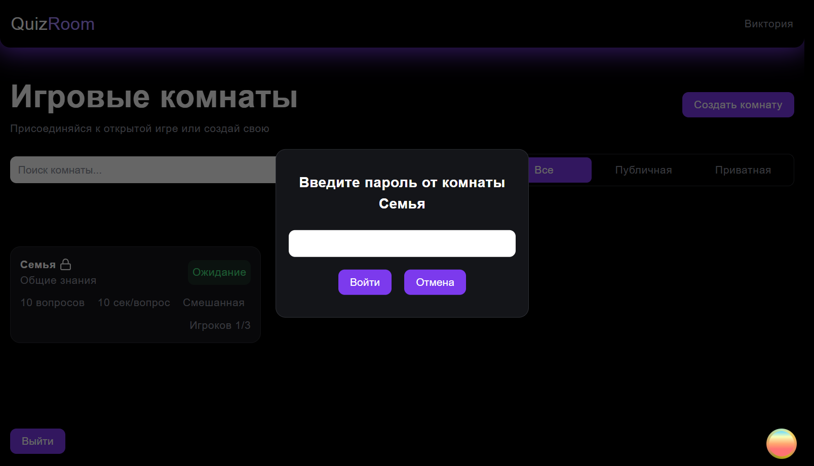
  </a>
  <p><sub>Вход в защищённую комнату из общего списка</sub></p>
</div>

| Подтверждение приглашения | Пароль при входе |
|:---:|:---:|
| <a href="./assets/readme/invite-confirmation.png">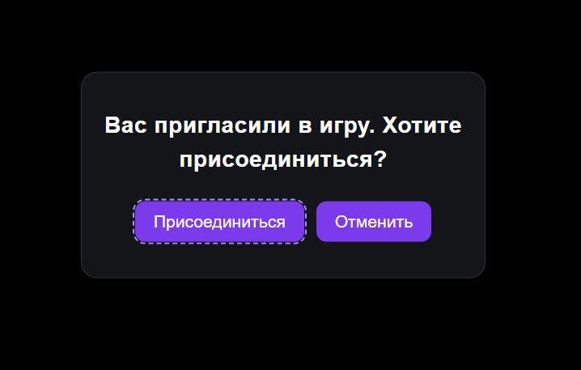</a> | <a href="./assets/readme/invite-password.png">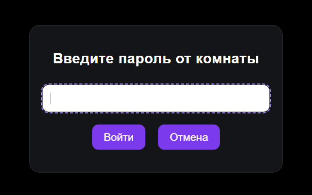</a> |

</details>

---

## 🎯 Как проходит игра

```text
Гостевой вход
      │
      ▼
Список комнат ──────► Создание своей комнаты
      │                         │
      └────────────┬────────────┘
                   ▼
           Лобби участников
                   │
         Игроки нажимают «Готов»
                   │
            Хост запускает игру
                   │
                   ▼
           Вопрос + таймер
                   │
             Выбор ответа
                   │
                   ▼
       Показ правильного ответа
                   │
             Следующий раунд
                   │
                   ▼
           Таблица результатов
                   │
                   ▼
            Возврат в лобби
```

Игроки проходят один и тот же матч, а интерфейс переключается между фазами **ответа**, **показа правильного варианта** и **завершённой игры**. Во время игры отображается текущий рейтинг, а после последнего вопроса — победитель, итоговые очки и количество правильных ответов каждого участника.

---

## 🛠 Технологический стек

| Технология | Для чего используется |
|---|---|
| **React** | Компонентный интерфейс и управление состоянием отображения |
| **TypeScript** | Типизация компонентов, API, событий и доменных моделей |
| **Vite** | Быстрый dev-сервер и production-сборка |
| **React Router** | Маршрутизация, защищённые страницы, параметры URL, lazy loading |
| **TanStack Query** | Запросы, мутации, кеширование и синхронизация серверного состояния |
| **Socket.IO Client** | Подписка на события комнат и игр в реальном времени |
| **React Hook Form** | Управление формами и состоянием полей |
| **Zod + @hookform/resolvers** | Валидация форм и проверка структуры ответов API |
| **SCSS / Sass** | Стили, переменные, миксины, адаптивная типографика |
| **Radix UI** | Доступные диалоговые окна / модальные интерфейсы |
| **React Hot Toast** | Уведомления об успехе и ошибках |
| **react-circular-progressbar** | Круговой индикатор времени ответа |
| **clsx** | Условные CSS-классы для состояний интерфейса |
| **React Query Devtools** | Отладка запросов и кеша при разработке |

Дополнительно используются **SVG-иконки**, локальные шрифты **Inter**, собственные UI-компоненты, ESLint и TypeScript-проверка сборки.

---

## 🧱 Архитектура: Feature-Sliced Design

Структура Frontend построена по принципам **Feature-Sliced Design (FSD)**. Код разделён по ответственности: от конфигурации приложения и самостоятельных страниц до пользовательских действий, бизнес-сущностей и переиспользуемых компонентов.

```text
src/
├── app/                  # Точка сборки приложения
│   ├── Routing/          # Маршруты, lazy loading, Suspense
│   ├── layouts/          # Layout, проверка сессии, Socket.IO
│   └── providers/        # TanStack Query
│
├── pages/                # Страницы приложения
│   ├── WelcomePage/
│   ├── RoomsPage/
│   ├── CreateRoomPage/
│   ├── InviteRoomPage/
│   ├── RoomPage/
│   ├── UpdateRoomPage/
│   ├── GamePage/
│   └── NotFoundPage/
│
├── widgets/              # Крупные блоки интерфейса
│   ├── Rooms/
│   ├── Lobby/
│   ├── Game/
│   ├── InviteRoom/
│   ├── Header/
│   └── Footer/
│
├── features/             # Сценарии и действия пользователя
│   ├── guest-session/
│   ├── create-room-form/
│   ├── join-room/
│   ├── update-room-settings/
│   ├── room-ready/
│   ├── start-game/
│   ├── submit-answer/
│   ├── leave-room/
│   └── leave-game/
│
├── entities/             # Данные и модели предметной области
│   ├── room/
│   ├── roomPlayer/
│   ├── guestPlayer/
│   ├── game/
│   ├── gamePlayer/
│   ├── question/
│   ├── round/
│   └── playerAnswer/
│
└── shared/               # Общая инфраструктура и UI
    ├── api/              # HTTP-клиент, endpoints, Socket.IO
    ├── ui/               # Button, Field, Modal, Timer и др.
    ├── hooks/            # Переиспользуемые хуки
    ├── lib/              # Общие схемы валидации
    ├── config/           # Настройки и варианты квиза
    ├── styles/           # Глобальные стили и SCSS-хелперы
    └── assets/           # Иконки и шрифты
```

**Пример разделения ответственности:**

- `entities/room` описывает комнату и запросы к API;
- `features/update-room-settings` реализует сценарий изменения настроек;
- `entities/room/ui/RoomSettingsForm` содержит переиспользуемую форму создания и редактирования;
- `widgets/Lobby` объединяет данные участников и доступные действия;
- `pages/RoomPage` собирает страницу и обрабатывает её состояния;
- `app` подключает маршрутизацию, layout и глобальные провайдеры.

Такой подход помогает **изолировать изменения, повторно использовать UI и не превращать страницы в большие компоненты со смешанной логикой**.

---

## ⚡ Real-time: Socket.IO + TanStack Query

Одна из главных технических особенностей QuizRoom — разделение **уведомлений об изменениях** и **самих данных**.

Вместо хранения отдельной полной копии состояния игры внутри WebSocket-клиента используется следующий подход:

1. Интерфейс получает актуальные данные через HTTP и `useQuery`.
2. Socket.IO уведомляет о событиях: `rooms:updated`, `room:updated`, `game:started`, `game:updated`.
3. Обработчик события инвалидирует соответствующий запрос TanStack Query.
4. Клиент повторно получает актуальное состояние и обновляет интерфейс.

**Зачем это сделано:**

- HTTP остаётся источником актуального состояния;
- нет необходимости вручную синхронизировать большие объекты между WebSocket и кешем;
- события подписаны на конкретные комнаты и игры;
- после переподключения клиент повторно подписывается на канал и обновляет данные;
- UI получает единый механизм обновления через TanStack Query.

Для мутаций используется тот же кеш: например, после изменения настроек возвращённая сервером комната сразу записывается через `queryClient.setQueryData`, а список комнат помечается устаревшим.

---

## 💡 Интересные технические решения

### 1. Типобезопасная работа с API

Общий `httpClient` использует `fetch` с `credentials: "include"` и нормализует HTTP-ошибки через `HttpError`. Ответы ключевых запросов проверяются Zod-схемами, поэтому TypeScript-типы подкрепляются **проверкой данных во время выполнения**.

### 2. Формы создания и изменения комнаты без дублирования

Один `RoomSettingsForm` используется в двух режимах — `create` и `edit`. React Hook Form управляет полями, `Controller` связывает их с кастомными `OptionGroup`, а Zod проверяет бизнес-правила, включая обязательный пароль для новой приватной комнаты.

### 3. Предсказуемая работа игрового таймера

Таймер рассчитывает остаток не только по локальному счётчику, а относительно полученного от сервера `phaseEndsAt`. Это позволяет отображать оставшееся время корректнее при повторном рендере и возвращении на страницу.

### 4. Состояния игрового процесса через discriminated unions

Zod-схемы описывают разные состояния игры: `answering`, `reveal` и `finished`. Поэтому интерфейс показывает правильный ответ только в фазе раскрытия, а в завершённой игре переключается на `GameResults`.

### 5. Состояние поиска хранится в URL

Поиск, фильтр приватности и текущая страница списка комнат синхронизированы с `URLSearchParams`. Поиск использует `useDebounce`, а пагинация — `keepPreviousData`, чтобы список не дёргался при каждом переключении страницы.

### 6. Компоненты с учётом UX

Для интерфейса реализованы состояния загрузки, блокировки действий при запросах, уведомления об ошибках и успехе, формы с текстами валидации, модальные окна на Radix UI, выделение выбранного и правильного ответа, адаптивные стили и видимые состояния фокуса.

### 7. Гостевой сценарий без отдельной регистрации

Frontend работает с серверной гостевой сессией через cookie. Проверка доступности страниц вынесена в `SessionGuard`: неавторизованный гость направляется на экран входа, а авторизованный — в приложение.

---


## 🚀 Локальный запуск

### Требования

- Node.js и pnpm;
- запущенный API-сервер QuizRoom с поддержкой Socket.IO.

**1. Склонировать frontend-репозиторий**

```bash
git clone <URL_ТВОЕГО_FRONTEND_РЕПОЗИТОРИЯ>
cd <ИМЯ_ПАПКИ_ПРОЕКТА>
```

**2. Установить зависимости**

```bash
pnpm install
```

**3. Создать `.env` в корне Frontend**

```dotenv
VITE_API_URL=http://localhost:3000/api
VITE_SOCKET_URL=http://localhost:3000
```

> Пример адресов выше рассчитан на локальный API на порту `3000`. Если твой сервер работает на другом порту или с другим префиксом, укажи соответствующие значения. HTTP- и Socket.IO-подключения должны быть разрешены конфигурацией сервера.

**4. Запустить приложение**

```bash
pnpm dev
```

После запуска открой URL, который Vite покажет в терминале (обычно `http://localhost:5173`).

### Дополнительные команды

```bash
pnpm build     # TypeScript-проверка и production-сборка
pnpm preview   # Локальный просмотр собранной версии
pnpm lint      # Проверка ESLint
```

---

<div align="center">

### QuizRoom — не просто викторина, а полноценный real-time frontend

Проект объединяет **пользовательские сценарии, формы, типизированный API, WebSocket-события, серверное состояние и компонентную архитектуру** в одном приложении.

**Создан для практики современной Frontend-разработки и многопользовательского UX.**

</div>
